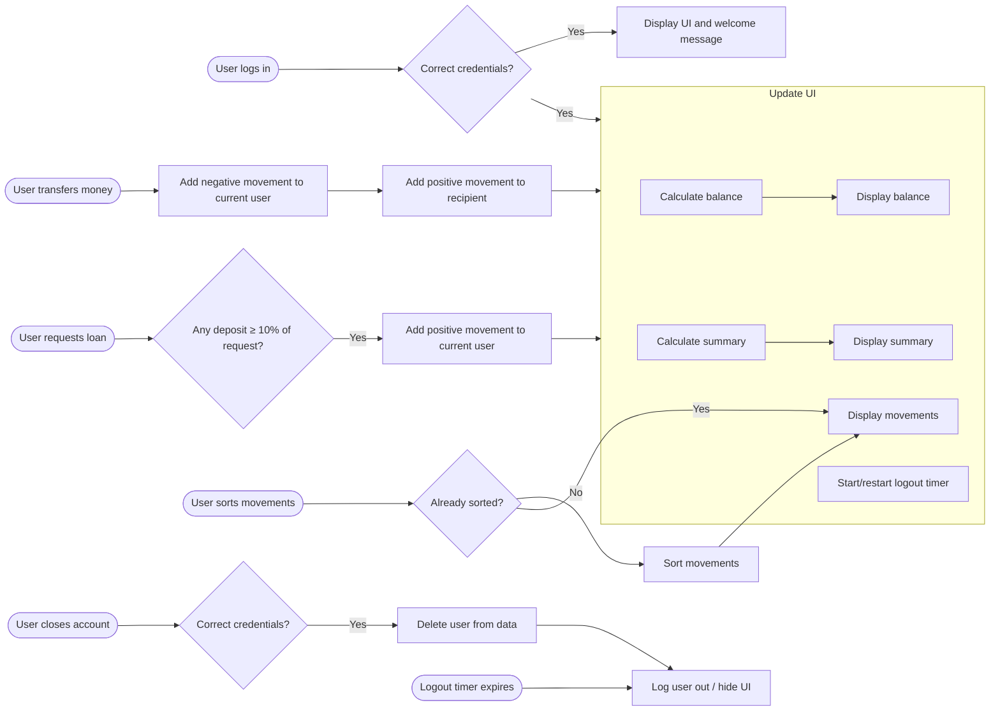

<p align="center">
  
</p>

<h1 align="center">Bastion</h1>

<p align="center">
  A minimalist banking app built with vanilla JavaScript, HTML and CSS.
</p>

---

## About

Bastion is a simple, front-end banking app. Users log in with a username and PIN to see their balance, transactions and account summary. From there they can transfer money, request a loan, sort their transactions or close their account. A logout timer ends the session automatically when the user is inactive.

It's a practice project for DOM manipulation, array methods (`map`, `filter`, `reduce`, `find`, `some`, `sort`…), events and timers, with no frameworks.

> ⚠️ This is a learning project. There is no backend or real authentication, and all data lives in memory.

## Features

- 🔐 **Login** with username and PIN
- 💰 **Current balance**, calculated from all movements
- 📊 **Summary** of money in, money out and interest earned
- 📜 **Transaction list** with deposits and withdrawals
- ↕️ **Sort transactions** by amount (toggles sorted/original order)
- 💸 **Transfer money** to another user
- 🏦 **Request a loan**, approved only if there's a deposit of at least 10% of the requested amount
- ❌ **Close account** after confirming username and PIN
- ⏱️ **Auto logout timer** (5 minutes), which restarts on every action
- 📱 **Responsive UI** for desktop, tablet and mobile

## App flow



## Demo accounts

Usernames are the owner's initials in lowercase.

| Owner                  | Username | PIN  |
| ---------------------- | -------- | ---- |
| Rahatul Ahsan          | `ra`     | 1111 |
| Jannatul Ferdous       | `jf`     | 2222 |
| Steven Thomas Williams | `stw`    | 3333 |
| Sarah Smith            | `ss`     | 4444 |

## Tech stack

- **HTML5**, with semantic layout
- **CSS3**, using Grid, Flexbox, custom properties and media queries
- **Vanilla JavaScript (ES6+)**
- Fonts: [Plus Jakarta Sans](https://fonts.google.com/specimen/Plus+Jakarta+Sans) and [JetBrains Mono](https://fonts.google.com/specimen/JetBrains+Mono)

## Project structure

```
bankist/
├── index.html    # App markup
├── style.css     # Styles and responsive layout
├── script.js     # App data and logic
├── icon.svg      # Logo and favicon
└── README.md
```

## Getting started

1. Clone the repository:
   ```bash
   git clone https://github.com/rahatulahsan/bastion.git
   cd bastion
   ```
2. Open `index.html` in your browser, or use a local server such as the **Live Server** extension in VS Code.
3. Log in with one of the demo accounts above.

## Roadmap

- [x] Redesigned, responsive UI
- [ ] Login and display UI
- [ ] Calculate and display balance and summary
- [ ] Display movements
- [ ] Transfer money
- [ ] Request loan
- [ ] Sort movements
- [ ] Close account
- [ ] Logout timer
- [ ] Dates and internationalization (`Intl` API)

## License

For educational use only. The original project concept belongs to Jonas Schmedtmann.